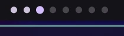

# Workspace Dots

A Noctalia bar widget for Hyprland that always shows workspaces 1–8, with separate visual states for the focused workspace, workspaces containing windows, and empty workspaces.

## Plugin

| Field | Value |
| --- | --- |
| ID | `feintt/workspace-dots` |
| Entries | Bar widget: `dots`; service: `state` |

## Requirements

- Noctalia with plugin API 43 or newer.
- A running Hyprland session with `hyprctl` and its `hyprctl eval` Lua API (`hl.dsp.focus`). Verified on Hyprland 0.57.0.
- Python 3.8 or newer (`python3`), using only the standard library.

## Usage

Enable `feintt/workspace-dots` in **Settings → Plugins**. Add the plugin's `dots` entry from the bar widget picker. The equivalent widget configuration is:

```toml
[widget.workspace_dots]
type = "feintt/workspace-dots:dots"
capsule = false
```

Click a dot to focus that numbered workspace. The tooltip reports its number and state. Focused dots use the primary theme color, occupied-but-unfocused dots use the secondary color, and empty dots use a subdued outline.

## Notes

- The display is global: every bar shows the same workspace IDs and window occupancy across all monitors. It does not maintain per-monitor dot states.
- Only normal workspaces numbered 1–8 are shown. Special and out-of-range workspaces do not shift or occupy a dot.
- The service starts `python3` to subscribe to Hyprland's event socket. On relevant workspace, window, or monitor events, it queries `hyprctl` for the current workspace snapshot. Clicking a dot runs `hl.dispatch(hl.dsp.focus(...))` through `hyprctl eval`.
- The plugin makes no network requests and writes no files. Its Python helper uses only the standard library.
- A screenshot of the eight-dot bar indicator:



## Development

Run the state-mapping regression tests from this directory:

```sh
python3 -m unittest -v
```
